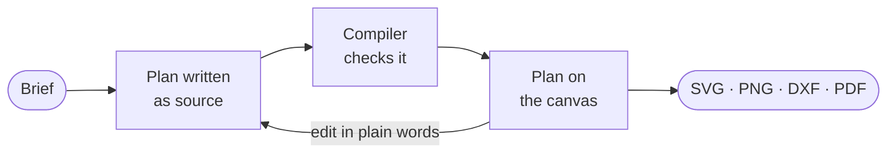

<div align="center">

<picture>
  <source media="(prefers-color-scheme: dark)" srcset="./assets/brand/wordmark-ondark.svg" />
  
</picture>

### Describe your build. Get a floor plan you can act on.

Describe your home in plain English. Get a dimensioned floor plan back, with a written list of everything it could not get right.

<a href="https://archcanvas.uk"></a> <a href="examples/"></a> <a href="ROADMAP.md"></a> <a href="https://github.com/ChanMeng666/archlang"></a>

</div>

<br>

<a href="https://archcanvas.uk/"></a>

<br>

<video src="https://github.com/user-attachments/assets/8986f197-f06c-49a7-ac4f-ddcab7f51abd" controls width="100%"></video>

<br>

## Try it

Open the studio at **[archcanvas.uk](https://archcanvas.uk)** and type a brief. A sentence is enough to start:

> *Three bedrooms, open kitchen-living, north-facing, roughly 110 m².*

You get one floor plan on an infinite canvas. Then you change it by talking to it: move a wall, resize a room, add an upstairs.

## Why it is different

- **One plan, not fifty.** A single consistent plan you shape until it is right.
- **Checked before you see it.** A compiler walks every route, measures every door and confirms every room is reachable. What it could not resolve is written on the drawing.
- **Yours to take away.** Export SVG, PNG, DXF, PDF or the editable source, one file per storey.



It is a concept plan, not a stamped permit set or construction documents.

## For your agent

This page is all a person needs. For the rest, clone the repo and point your coding agent at [`docs/overview.md`](docs/overview.md). The ten plans in [`examples/`](examples/) ship with their source, and each one recompiles on your own machine:

```bash
npx @chanmeng666/archlang compile examples/garden-office/plan.arch -o plan.svg
```

<sub>[Full overview](docs/overview.md) · [FAQ](docs/faq.md) · [Changelog](CHANGELOG.md) · [Discussions](https://github.com/archcanvas/archcanvas/discussions) · [Issues](https://github.com/archcanvas/archcanvas/issues) · [Contributing](CONTRIBUTING.md) · [Support](SUPPORT.md) · [Security](SECURITY.md) · [Two-minute film](https://youtu.be/rUZAiXgt9JY) · [License](LICENSE)</sub>

<sub>ArchCanvas is a commercial product and its application source is not open. The engine underneath, [ArchLang](https://github.com/ChanMeng666/archlang), is open source (MIT). Built by [Chan Meng](https://github.com/ChanMeng666).</sub>
